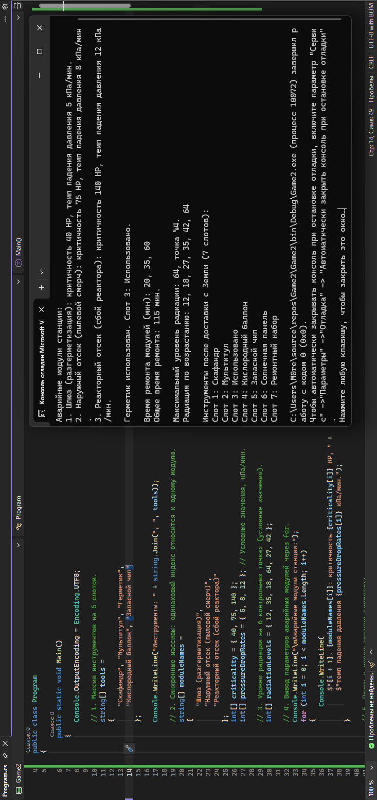
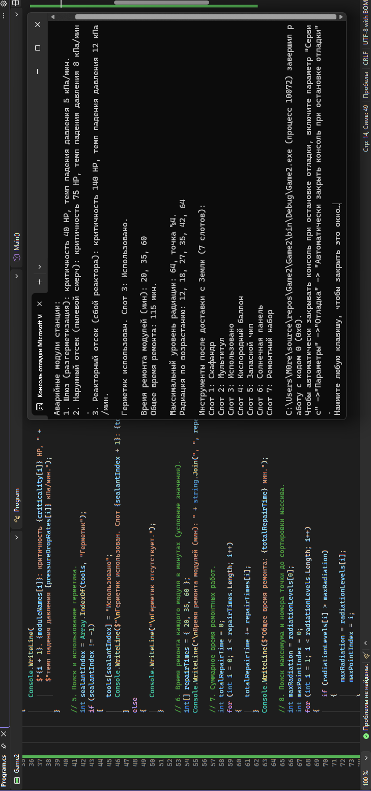
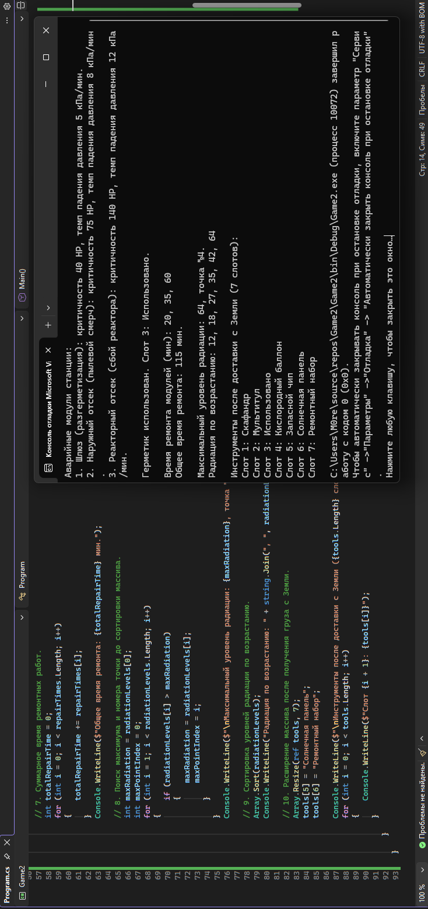

# Практическая работа №5. Одномерные массивы в C#

## Вариант 4. Колонизация Марса — инженер базы

**Программа:** Обработка одномерных массивов.

## Исходный код

```csharp
using System;
using System.Text;

namespace Game2
{
    public class Program
    {
        public static void Main()
        {
            Console.OutputEncoding = Encoding.UTF8;

            // 1. Массив инструментов на 5 слотов.
            string[] tools =
            {
                "Скафандр", "Мультитул", "Герметик",
                "Кислородный баллон", "Запасной чип"
            };

            Console.WriteLine("Инструменты: " + string.Join(", ", tools));

            // 2. Синхронные массивы: одинаковый индекс относится к одному модулю.
            string[] moduleNames =
            {
                "Шлюз (разгерметизация)",
                "Наружный отсек (пылевой смерч)",
                "Реакторный отсек (сбой реактора)"
            };
            int[] criticality = { 40, 75, 140 };
            int[] pressureDropRates = { 5, 8, 12 }; // Условные значения, кПа/мин.

            // 3. Уровни радиации на 6 контрольных точках (условные значения).
            int[] radiationLevels = { 12, 35, 18, 64, 27, 42 };

            // 4. Вывод параметров аварийных модулей через for.
            Console.WriteLine("\nАварийные модули станции:");
            for (int i = 0; i < moduleNames.Length; i++)
            {
                Console.WriteLine(
                    $"{i + 1}. {moduleNames[i]}: критичность {criticality[i]} HP, " +
                    $"темп падения давления {pressureDropRates[i]} кПа/мин.");
            }

            // 5. Поиск и использование герметика.
            int sealantIndex = Array.IndexOf(tools, "Герметик");
            if (sealantIndex != -1)
            {
                tools[sealantIndex] = "Использовано";
                Console.WriteLine($"\nГерметик использован. Слот {sealantIndex + 1}: {tools[sealantIndex]}.");
            }
            else
            {
                Console.WriteLine("\nГерметик отсутствует.");
            }

            // 6. Время ремонта каждого модуля в минутах (условные значения).
            int[] repairTimes = { 20, 35, 60 };
            Console.WriteLine("\nВремя ремонта модулей (мин): " + string.Join(", ", repairTimes));

            // 7. Суммарное время ремонтных работ.
            int totalRepairTime = 0;
            for (int i = 0; i < repairTimes.Length; i++)
            {
                totalRepairTime += repairTimes[i];
            }
            Console.WriteLine($"Общее время ремонта: {totalRepairTime} мин.");

            // 8. Поиск максимума и номера точки до сортировки массива.
            int maxRadiation = radiationLevels[0];
            int maxPointIndex = 0;
            for (int i = 1; i < radiationLevels.Length; i++)
            {
                if (radiationLevels[i] > maxRadiation)
                {
                    maxRadiation = radiationLevels[i];
                    maxPointIndex = i;
                }
            }
            Console.WriteLine($"\nМаксимальный уровень радиации: {maxRadiation}, точка №{maxPointIndex + 1}.");

            // 9. Сортировка уровней радиации по возрастанию.
            Array.Sort(radiationLevels);
            Console.WriteLine("Радиация по возрастанию: " + string.Join(", ", radiationLevels));

            // 10. Расширение массива после получения груза с Земли.
            Array.Resize(ref tools, 7);
            tools[5] = "Солнечная панель";
            tools[6] = "Ремонтный набор";

            Console.WriteLine($"\nИнструменты после доставки с Земли ({tools.Length} слотов):");
            for (int i = 0; i < tools.Length; i++)
            {
                Console.WriteLine($"Слот {i + 1}: {tools[i]}");
            }
        }
    }
}
```

## Скриншоты работы программы

### Скриншот 1



### Скриншот 2



### Скриншот 3



