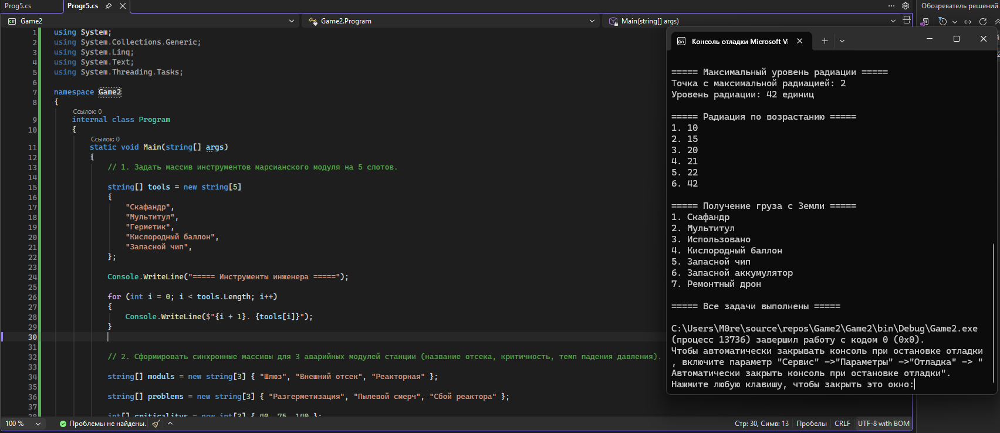
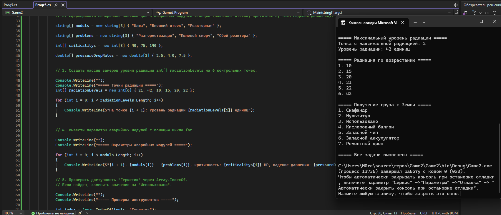
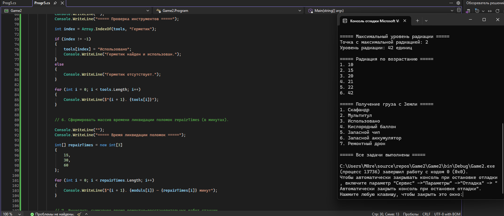
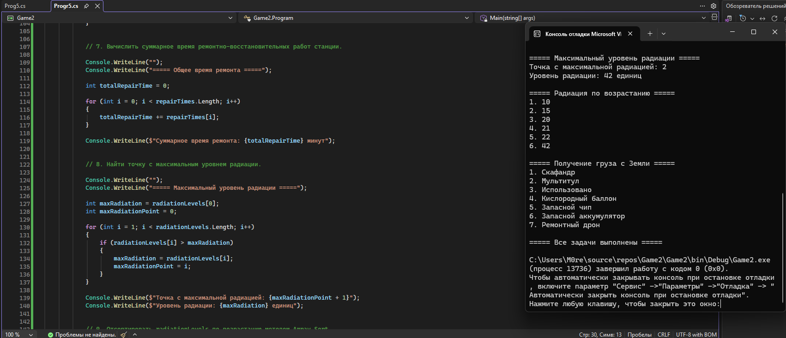
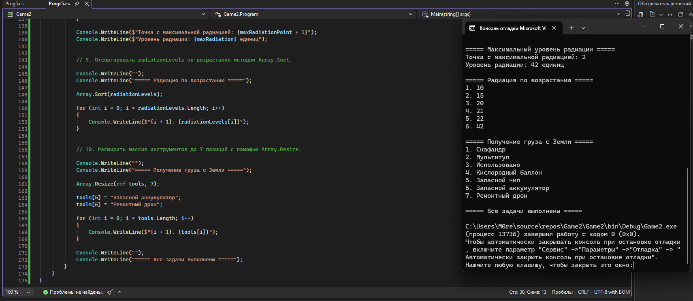

# Game2 — Колонизация Марса

Практическая работа №5 «Одномерные массивы в C#». Вариант 4 — «Инженер базы».

Консольная программа выводит инструменты и параметры аварийных модулей, использует герметик, рассчитывает общее время ремонта, находит максимальный уровень радиации, сортирует замеры и расширяет инвентарь после получения груза с Земли.


## Исходный код

```csharp
using System;
using System.Collections.Generic;
using System.Linq;
using System.Text;
using System.Threading.Tasks;

namespace Game2
{
    internal class Program
    {
        static void Main(string[] args)
        {
            // 1. Задать массив инструментов марсианского модуля на 5 слотов.

            string[] tools = new string[5]
            {
                "Скафандр",
                "Мультитул",
                "Герметик",
                "Кислородный баллон",
                "Запасной чип",
            };

            Console.WriteLine("===== Инструменты инженера =====");

            for (int i = 0; i < tools.Length; i++)
            {
                Console.WriteLine($"{i + 1}. {tools[i]}");
            }


            // 2. Сформировать синхронные массивы для 3 аварийных модулей станции (название отсека, критичность, темп падения давления).

            string[] moduls = new string[3] { "Шлюз", "Внешний отсек", "Реакторная" };

            string[] problems = new string[3] { "Разгерметизация", "Пылевой смерч", "Сбой реактора" };

            int[] criticalitys = new int[3] { 40, 75, 140 };

            double[] pressureDropRates = new double[3] { 2.5, 4.0, 7.5 };


            // 3. Создать массив замеров уровня радиации int[] radiationLevels на 6 контрольных точек.

            Console.WriteLine("");
            Console.WriteLine("===== Точки радиации =====");
            int[] radiationLevels = new int[6] { 21, 42, 10, 15, 20, 22 };

            for (int i = 0; i < radiationLevels.Length; i++)
            {
                Console.WriteLine($"На точке {i + 1}: Уровень радиации {radiationLevels[i]} единиц");
            }


            // 4. Вывести параметры аварийных модулей с помощью цикла for.

            Console.WriteLine("");
            Console.WriteLine("===== Параметры аварийных модулей =====");

            for (int i = 0; i < moduls.Length; i++)
            {
                Console.WriteLine($"{i + 1}. {moduls[i]} - {problems[i]}, критичность: {criticalitys[i]} HP, падение давления: {pressureDropRates[i]} кПа/мин");
            }

            // 5. Проверить доступность "Герметик" через Array.IndexOf.
            // Если найден, заменить значение на "Использовано".

            Console.WriteLine("");
            Console.WriteLine("===== Проверка инструментов =====");

            int index = Array.IndexOf(tools, "Герметик");

            if (index != -1)
            {
                tools[index] = "Использовано";
                Console.WriteLine("Герметик найден и использован.");
            }
            else
            {
                Console.WriteLine("Герметик отсутствует.");
            }

            for (int i = 0; i < tools.Length; i++)
            {
                Console.WriteLine($"{i + 1}. {tools[i]}");
            }


            // 6. Сформировать массив времени ликвидации поломок repairTimes (в минутах).

            Console.WriteLine("");
            Console.WriteLine("===== Время ликвидации поломок =====");

            int[] repairTimes = new int[3]
            {
                15,
                30,
                60
            };

            for (int i = 0; i < repairTimes.Length; i++)
            {
                Console.WriteLine($"{i + 1}. {moduls[i]} — {repairTimes[i]} минут");
            }


            // 7. Вычислить суммарное время ремонтно-восстановительных работ станции.

            Console.WriteLine("");
            Console.WriteLine("===== Общее время ремонта =====");

            int totalRepairTime = 0;

            for (int i = 0; i < repairTimes.Length; i++)
            {
                totalRepairTime += repairTimes[i];
            }

            Console.WriteLine($"Суммарное время ремонта: {totalRepairTime} минут");


            // 8. Найти точку с максимальным уровнем радиации.

            Console.WriteLine("");
            Console.WriteLine("===== Максимальный уровень радиации =====");

            int maxRadiation = radiationLevels[0];
            int maxRadiationPoint = 0;

            for (int i = 1; i < radiationLevels.Length; i++)
            {
                if (radiationLevels[i] > maxRadiation)
                {
                    maxRadiation = radiationLevels[i];
                    maxRadiationPoint = i;
                }
            }

            Console.WriteLine($"Точка с максимальной радиацией: {maxRadiationPoint + 1}");
            Console.WriteLine($"Уровень радиации: {maxRadiation} единиц");


            // 9. Отсортировать radiationLevels по возрастанию методом Array.Sort.

            Console.WriteLine("");
            Console.WriteLine("===== Радиация по возрастанию =====");

            Array.Sort(radiationLevels);

            for (int i = 0; i < radiationLevels.Length; i++)
            {
                Console.WriteLine($"{i + 1}. {radiationLevels[i]}");
            }


            // 10. Расширить массив инструментов до 7 позиций с помощью Array.Resize.

            Console.WriteLine("");
            Console.WriteLine("===== Получение груза с Земли =====");

            Array.Resize(ref tools, 7);

            tools[5] = "Запасной аккумулятор";
            tools[6] = "Ремонтный дрон";

            for (int i = 0; i < tools.Length; i++)
            {
                Console.WriteLine($"{i + 1}. {tools[i]}");
            }

            Console.WriteLine("");
            Console.WriteLine("===== Все задачи выполнены =====");
        }
    }
}
```

## Скриншоты работы программы

### Скриншот 1



### Скриншот 2



### Скриншот 3



### Скриншот 4



### Скриншот 5



